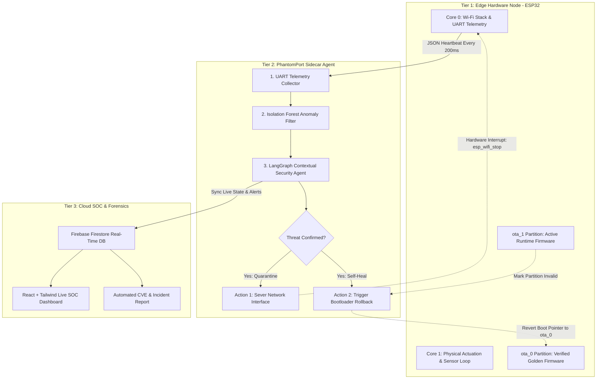

# PhantomPort 🛡️
> **Autonomous Edge-IoT Hardware Quarantine & Self-Healing Firmware Sentinel**

[](LICENSE)
[]()
[]()
[]()

---

## 📌 Executive Summary
**PhantomPort** is an autonomous sidecar AI security agent designed to protect resource-constrained edge IoT devices from firmware exploits and supply-chain compromises without causing physical operational downtime. 

By offloading anomaly detection to an external watchdog agent via UART/SPI telemetry streaming, PhantomPort continuously inspects microcontroller runtime parameters (heap memory spikes, anomalous GPIO transitions, and unauthorized TCP/DNS requests) with **< 2% onboard overhead**. When a threat or data exfiltration attempt is confirmed, the agent dynamically severs the microcontroller's network interface—air-gapping the device into a "Phantom Port" while keeping physical sensor and actuator loops running uninterrupted. The agent then commands the hardware bootloader to execute an autonomous dual-partition rollback to a cryptographically verified **Golden Firmware (`ota_0`)** image in under 2 seconds.

---

## 🚨 The Edge IoT Security Dilemma
1. **Zero Endpoint Detection (EDR) Capacity:** Edge nodes (ESP32, STM32, PLCs) power critical infrastructure but lack the RAM/CPU overhead to run traditional security software.
2. **Vulnerable OTA Pipelines:** Compromised firmware builds or injected third-party dependencies expose industrial systems to remote hijacking and botnet recruitment.
3. **The "Brick or Breach" Tradeoff:** Current mitigation strategies require remotely cutting power to a compromised node, resulting in catastrophic downtime in smart grids, healthcare monitors, or manufacturing production lines.

---

## ⚙️ System Architecture



### Architectural Breakdown by Tier
| Architectural Tier | Core Components | Operational Role |
| :--- | :--- | :--- |
| **Tier 1: Edge Hardware (ESP32)** | Dual-Core MCU, Custom A/B Flash Table (`ota_0`, `ota_1`), Local Relay/Sensor Loop | Runs critical physical actuation on Core 1 while streaming lightweight runtime telemetry from Core 0 over UART. |
| **Tier 2: Sidecar Sentinel Agent** | Python FastAPI, Scikit-Learn Isolation Forest, LangGraph State Machine | Evaluates telemetry drift in real time; fires hardware interrupts to sever Wi-Fi and trigger bootloader recovery upon breach detection. |
| **Tier 3: Cloud SOC Command Center** | Firebase Firestore, React (Vite), Tailwind CSS | Visualizes live device quarantine states, memory heap graphs, and generates automated post-rollback forensic reports. |

---

## 🔄 4-Stage Operational Lifecycle

1. **Continuous Telemetry Streaming (Perception):** The microcontroller broadcasts a compact JSON telemetry frame over UART every 200ms:
   ```json
   {
     "free_heap": 182400,
     "active_sockets": 1,
     "outbound_dst_ip": "192.168.1.10",
     "cpu_load": 14.2,
     "gpio_state": 4
   }
   ```
2. **Dual-Stage Behavioral Reasoning (Cognition):**
   * **Fast Filter:** A lightweight Isolation Forest flags sudden heap fragmentation drops and socket anomalies.
   * **Agent Evaluation:** LangGraph cross-references device identity and active network destinations. If an anomalous shell spawn or outbound exfiltration pattern is identified, it initiates the quarantine workflow.
3. **Dynamic Air-Gapping (Quarantine):** The agent signals an immediate network isolation interrupt (`esp_wifi_stop()`). The device cuts all inbound/outbound wireless communication while the local sensor/actuator tasks on Core 1 continue running uninterrupted.
4. **Autonomous Dual-Partition Rollback (Self-Healing):** The agent dispatches a hardware bootloader directive. Using `esp_ota_mark_app_invalid_rollback_and_reboot()`, the ESP32 invalidates the compromised partition (`ota_1`), reverts boot pointers to the verified Golden Image (`ota_0`), and boots into a clean state in ~1.8 seconds.

---

## 🛠️ Technology Stack

| Domain | Technology | Purpose |
| :--- | :--- | :--- |
| **Embedded Hardware** | ESP32 Dual-Core MCU (NodeMCU-32S) | Edge physical computing & sensor/relay actuation |
| **Firmware Framework** | C/C++ (ESP-IDF / Arduino Core) | Dual A/B partition management & hardware interrupts |
| **Sidecar Agent** | Python 3.11+, LangGraph, FastAPI | Autonomous state-machine & reasoning engine |
| **Anomaly Detection** | Scikit-Learn (Isolation Forest) | Statistical deviation scoring on runtime telemetry |
| **Real-Time Database**| Google Firebase Firestore | Zero-latency device state synchronization |
| **SOC Dashboard** | React (Vite), Tailwind CSS | Live operator telemetry graph & incident reports |

---

## 📂 Repository Structure

```text
PhantomPort/
├── firmware/
│   ├── partitions.csv               # Custom A/B partition table (otadata, ota_0, ota_1)
│   ├── golden_firmware_v1.0/        # Stable, verified reference image
│   └── poisoned_firmware_v1.1/      # Simulated supply-chain exploit build for demo
├── agent/
│   ├── main.py                      # FastAPI entry point & serial listener
│   ├── langgraph_sentinel.py        # Autonomous decision state-machine
│   ├── anomaly_detector.py          # Isolation Forest model on heap/socket logs
│   └── serial_bridge.py             # Bi-directional UART communication interface
├── dashboard/
│   ├── src/                         # React + Vite SOC frontend
│   └── firebase_config.js           # Real-time Firestore configuration
├── docs/
│   ├── system_architecture.png      # High-resolution block diagrams
│   └── hackathon_pitch_deck.pdf     # Project presentation deck
├── LICENSE
└── README.md
```

---

## ⚡ Live Hackathon Demo Proof-of-Concept

* **Stage 1 (Normal Operations):** ESP32 executes `v1.0 Golden Firmware` (`ota_0`), managing a physical relay circuit while streaming nominal telemetry to the React dashboard.
* **Stage 2 (Exploit Injection):** An OTA flash update introduces `v1.1 Active Firmware` (`ota_1`) containing an obfuscated socket routine that initiates unauthorized outbound data transmissions.
* **Stage 3 (Automated Mitigation):** The sidecar agent catches the anomalous socket burst and memory drop, executes an immediate Wi-Fi shutdown, verifies relay continuity, executes an autonomous firmware rollback to `ota_0`, and populates an incident log in under 2 seconds.

---

## 👥 Engineering Team
* **Garv Goel** - *Embedded Systems & Agentic Architecture*AI & Anomaly Detection Modeling*
* **C M Keerthana** - *Backend & Cloud Systems Lead Frontend & SOC Dashboard Engineering*

---
*Developed for the Agentic AI Hackathon 2026.*
